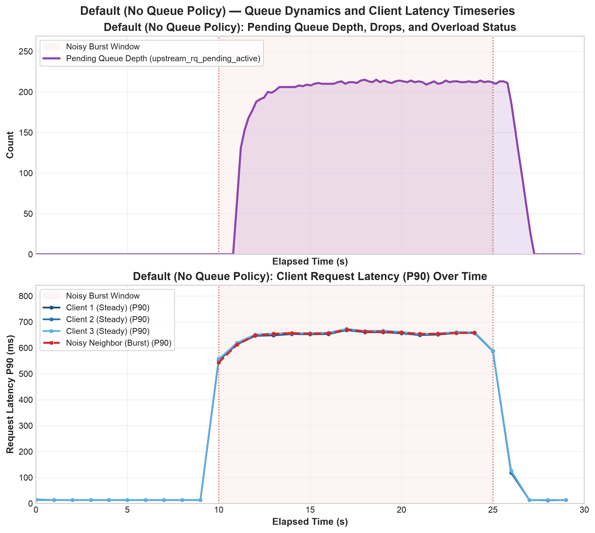
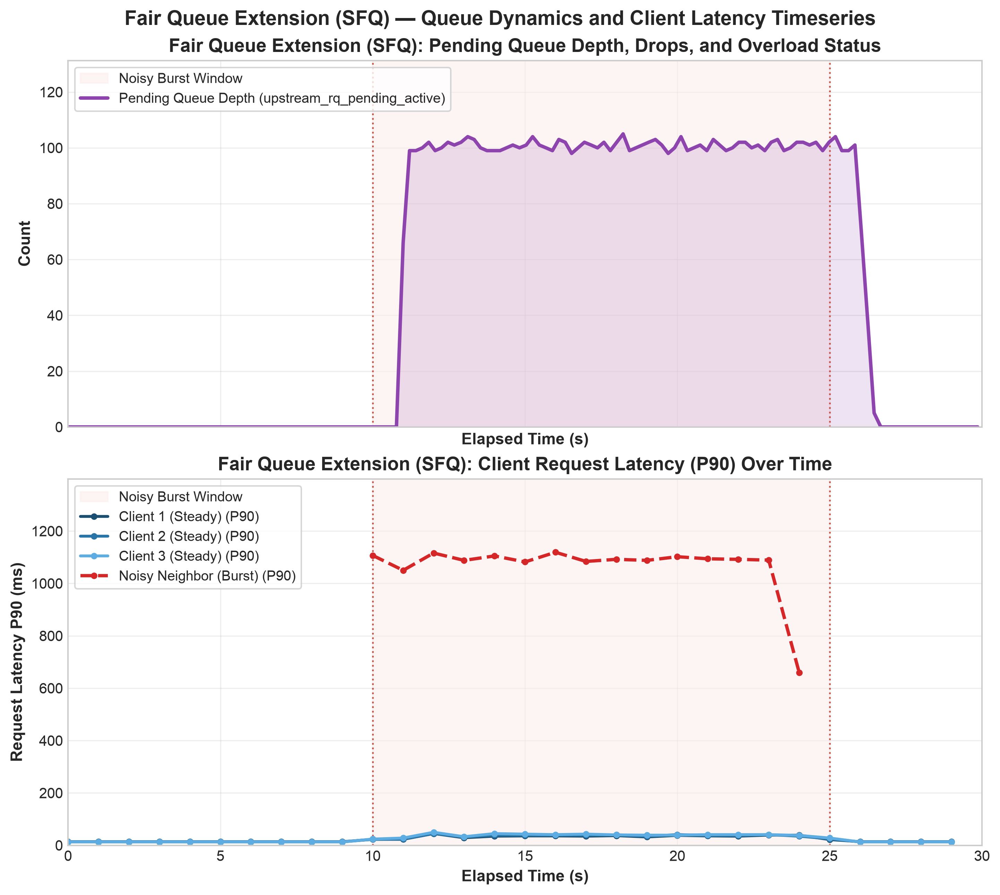

.. _config_cluster_manager_pending_request_queueing:

Pending request queueing
========================

When no upstream connection is immediately available, a connection pool may queue a request while
it establishes a connection or waits for connection capacity. The
:ref:`maximum pending requests circuit breaker
<envoy_v3_api_field_config.cluster.v3.CircuitBreakers.Thresholds.max_pending_requests>` limits how
many requests may wait. A queue policy controls the order in which those requests are selected when
capacity becomes available; it does not change the circuit breaker limit.

The policy is configured with
:ref:`Cluster.queuing_policies
<envoy_v3_api_field_config.cluster.v3.Cluster.queuing_policies>`. If no policy is configured, Envoy
uses FIFO ordering.

Queue policies
--------------

FIFO
~~~~

The :ref:`FIFO queue policy
<envoy_v3_api_msg_extensions.queue_policy.fifo.v3.FifoQueuePolicyConfig>` selects the oldest
pending request first.

Adaptive LIFO
~~~~~~~~~~~~~

The :ref:`adaptive LIFO queue policy
<envoy_v3_api_msg_extensions.queue_policy.adaptive_lifo.v3.AdaptiveLifoQueuePolicyConfig>` uses FIFO
ordering until the queue size reaches the configured high watermark. It then selects the most
recently queued request until the queue size reaches or falls below the low watermark. The
watermarks are absolute request counts applied independently to each connection pool's pending
request queue.
Separate watermarks prevent the policy from repeatedly switching order near the overload boundary.

Adaptive LIFO prioritizes newer requests during overload. Older requests may wait longer, and under
sustained overload they may time out before being selected.

The following cluster fragment configures each connection pool to enter LIFO mode when it has 80
pending requests and return to FIFO mode when it has 60 or fewer pending requests:

.. code-block:: yaml

  queuing_policies:
    pending_rq_policy:
      name: envoy.queue_policy.adaptive_lifo
      typed_config:
        "@type": type.googleapis.com/envoy.extensions.queue_policy.adaptive_lifo.v3.AdaptiveLifoQueuePolicyConfig
        high_watermark: 80
        low_watermark: 60

Fair queue
~~~~~~~~~~

The :ref:`fair queue policy
<envoy_v3_api_msg_extensions.queue_policy.fair_queue.v3.FairQueuePolicyConfig>` uses Stochastic Fair
Queuing (SFQ) to isolate tenant or traffic classes waiting in a connection pool's pending request
queue.

In a FIFO queue, a single bursty tenant can fill the queue and delay all subsequent requests,
including requests from well-behaved tenants. Fair queue prevents this head-of-line blocking by
partitioning pending requests across multiple FIFO sub-queues (buckets) and serving active buckets
in round-robin order.

How it works
^^^^^^^^^^^^

1. **Classification**: Envoy extracts the class identifier from dynamic metadata using
   :ref:`class_metadata_key
   <envoy_v3_api_field_extensions.queue_policy.fair_queue.v3.FairQueuePolicyConfig.class_metadata_key>`.
   The value may be a string, number, or boolean.
2. **Default class**: Envoy assigns requests that lack the specified metadata key to a dedicated
   default class. Unclassified traffic shares a single bucket. This ensures unclassified bursts
   cannot pollute buckets assigned to classified tenants.
3. **Bucketing**: Envoy hashes the class identifier with 64-bit xxHash into one of
   :ref:`num_buckets
   <envoy_v3_api_field_extensions.queue_policy.fair_queue.v3.FairQueuePolicyConfig.num_buckets>`
   per-bucket FIFO queues (default 1024).
4. **Round-robin dequeue**: Non-empty buckets form a round-robin schedule. When an upstream
   connection becomes available, Envoy dequeues one request from the current bucket and advances
   to the next non-empty bucket. A burst from one tenant fills only that tenant's bucket, while other
   tenants continue to receive service immediately.
5. **Periodic perturbation**: Two distinct classes can occasionally hash to the same bucket.
   Envoy updates the hash seed every
   :ref:`perturbation_interval
   <envoy_v3_api_field_extensions.queue_policy.fair_queue.v3.FairQueuePolicyConfig.perturbation_interval>`
   (default 1s) based on the request enqueue timestamp. Arriving requests use the updated seed.
   Already-queued requests remain in their assigned buckets until dequeued. This periodic rotation
   breaks persistent collisions between tenants over time. Setting the interval to ``0s`` disables
   perturbation.

Configuration example
^^^^^^^^^^^^^^^^^^^^^

The following cluster fragment configures fair queuing across 1024 buckets with a 1-second
perturbation interval. It reads the ``tenant_id`` key from the
``envoy.filters.http.header_to_metadata`` metadata namespace:

.. code-block:: yaml

  queuing_policies:
    pending_rq_policy:
      name: envoy.queue_policy.fair_queue
      typed_config:
        "@type": type.googleapis.com/envoy.extensions.queue_policy.fair_queue.v3.FairQueuePolicyConfig
        class_metadata_key:
          key: envoy.filters.http.header_to_metadata
          path:
          - key: tenant_id
        num_buckets: 1024
        perturbation_interval: 1s

To populate this metadata from incoming HTTP request headers, configure the
:ref:`Header-To-Metadata filter <config_http_filters_header_to_metadata>` in the HTTP connection
manager filter chain:

.. code-block:: yaml

  http_filters:
  - name: envoy.filters.http.header_to_metadata
    typed_config:
      "@type": type.googleapis.com/envoy.extensions.filters.http.header_to_metadata.v3.Config
      request_rules:
      - header: x-tenant-id
        on_header_present:
          metadata_namespace: envoy.filters.http.header_to_metadata
          key: tenant_id
          type: STRING
  - name: envoy.filters.http.router
    typed_config:
      "@type": type.googleapis.com/envoy.extensions.filters.http.router.v3.Router

Impact on tenant isolation
^^^^^^^^^^^^^^^^^^^^^^^^^^

In an unconfigured connection pool (default FIFO ordering), an aggressive or bursty tenant can
fill the pending request queue when upstream connection capacity is constrained. Requests from
well-behaved tenants wait behind the backlog, suffering head-of-line blocking and inflated tail
latency:

With the fair queue policy enabled, Envoy partitions pending requests into per-class buckets
and services active buckets in round-robin order. A bursty tenant fills only its own bucket.
Envoy continues to dequeue requests from other tenants promptly, preserving low tail latency
without shedding traffic:

Observability
-------------

The ``upstream_rq_pending_active`` gauge reports the number of requests currently waiting for a
connection pool connection. For queue policies that report an overloaded state, such as adaptive
LIFO, ``upstream_queue_overloaded`` reports the number of connection pool pending request queues
currently overloaded. Both are documented in the :ref:`cluster statistics
<config_cluster_manager_cluster_stats>`.
